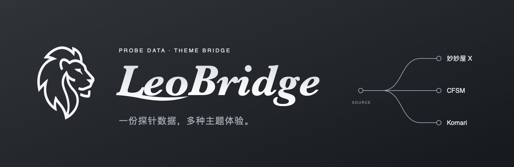
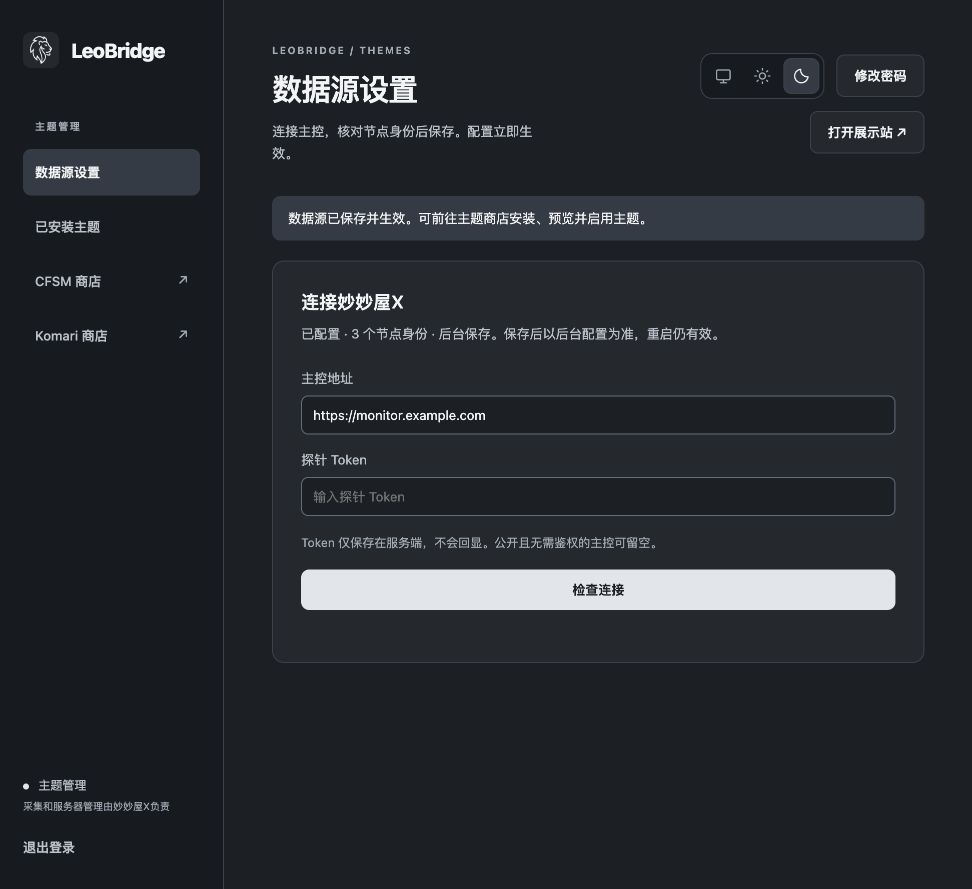
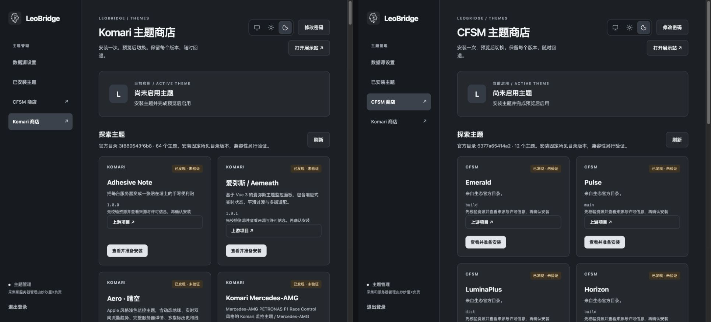

# LeoBridge

让妙妙屋X的探针数据，使用 CF-Server-Monitor 和 Komari 的主题展示。

LeoBridge 只读访问妙妙屋X探针 API，提供独立的 CFSM / Komari 展示协议和主题管理后台。采集、服务器管理和历史保存仍由妙妙屋X负责，无需安装新的 Agent。

## 功能

**网页配置数据源**：填写主控地址和 Token，检查连接、核对节点身份及 Ping 目标后保存。



**双生态主题商店**：浏览 CFSM 与 Komari 主题，查看来源、固定版本和许可信息后按需安装。



**预览、切换与回退**：先预览再启用，保留已安装版本，切换主题无需重新部署。

**状态、历史与实时更新**：转换已有探针数据，缺失指标保持未知，历史空缺不补点；支持 WebSocket 和 HTTP 回退。

项目默认不内置第三方主题。商店收录或安装成功不代表兼容，具体能力以[兼容说明](docs/research/compatibility.md)为准。

## 快速开始

普通用户选择[预编译运行包](docs/deployment/local.md)或[Docker Hub 镜像](docs/deployment/docker.md)。目前公开发行包和镜像尚未发布；发布后，下载对应平台运行包并解压，在目录中执行：

```sh
./leobridge.sh start
```

运行包自带运行环境，无需安装 Node 或 pnpm，启动时不会下载依赖或编译。默认后台运行，关闭终端后继续运行。用 `./leobridge.sh stop`、`restart`、`status`、`logs` 管理服务；加 `--quiet` 可隐藏正常输出。

1. 打开 [管理后台](http://127.0.0.1:8787/admin/)，首次使用 `admin` / `admin` 登录，按提示设置新密码并重新登录。
2. 进入「数据源设置」，填写妙妙屋X主控地址和探针 Token。点击「检查连接」，核对节点身份与 Ping 目标后保存。
3. 进入 CFSM 或 Komari 商店，查看来源与许可信息，勾选确认后安装主题。
4. 预览主题，确认显示正常后启用，打开 [展示首页](http://127.0.0.1:8787/)。

已有配置、管理密码和节点身份继续保留；首次在后台保存数据源后，以后台配置为准。高级配置及旧环境变量用法见[配置参考](docs/configuration.md)。

需要修改代码或自行制作产物时，使用[开发构建指南](docs/development/build.md)。Cloudflare Workers仍为后续适配方向。

## 文档与贡献

| 需要做什么 | 文档 |
| --- | --- |
| 部署、备份或升级 | [Docker Hub镜像](docs/deployment/docker.md) · [运行包](docs/deployment/local.md) |
| 配置数据源、节点身份和访问策略 | [配置参考](docs/configuration.md) |
| 安装、预览、启用或回退主题 | [主题管理](docs/themes.md) |
| 了解兼容范围与数据限制 | [兼容说明](docs/research/compatibility.md) |
| 排查连接、历史或实时问题 | [排障指南](docs/troubleshooting.md) |
| 开发与贡献代码 | [贡献指南](CONTRIBUTING.md) · [架构说明](docs/development/architecture.md) |

欢迎提交问题和改进建议。问题报告请附版本、运行方式和脱敏后的复现步骤；安全问题见[安全说明](SECURITY.md)。

## 致谢

感谢以下项目的作者与贡献者：

- [CF-Server-Monitor（CFSM）](https://github.com/huilang-me/CF-Server-Monitor)：提供前台、主题规范与主题生态。
- [Komari](https://github.com/komari-monitor/komari)：提供公开展示协议、主题机制与主题生态。

## 许可证

LeoBridge 原创代码采用 [MIT](LICENSE)。第三方主题、依赖、字体与图形遵循各自条款，来源及许可见[第三方声明](docs/references/retired-themes/README.md)。主题安装确认记录用户的知情决定，不作为授权证明；具体流程见[主题管理](docs/themes.md#主题获取与许可信息)。
