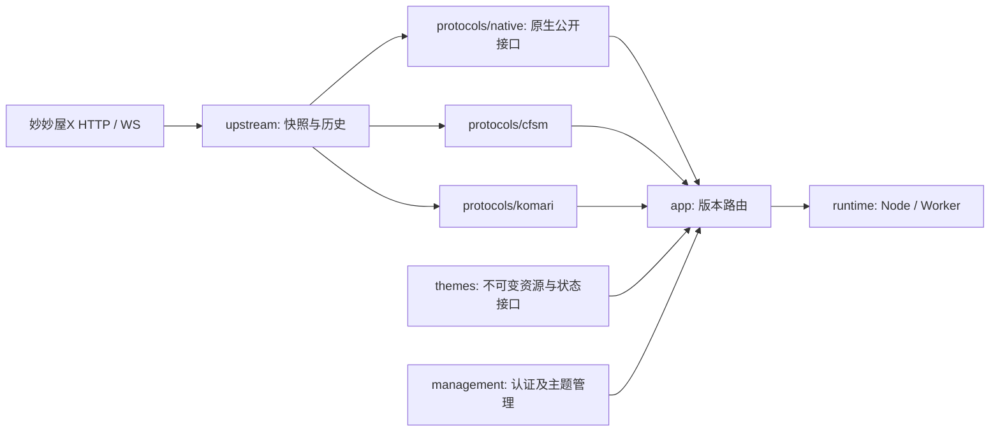

# 架构与目录约定

LeoBridge保持一个TypeScript项目、一个pnpm锁文件。用户交付采用Docker Hub镜像及自带Node的运行包两种方式；Worker入口保留供后续适配。按现有职责分层，不引入Monorepo框架、依赖注入容器或新数据库。

## 数据流与组合

这是数据/请求组合图，具体代码允许的导入方向以下表为准。共享模型和历史事实不含CFSM响应结构，两个协议各自转换；`app/protocols.ts`注入同一上游快照客户端，保持缓存与身份事实一致。默认single路由的根入口直接绑定当前活动主题，`/admin/`提供管理，切换活动主题关闭根入口旧实时连接。single预览以`__preview`参数绑定安装资源及协议；`app/preview.ts`负责浏览器请求/历史导航适配和同源资源Referer重定向，不修改原始包，不使用全局预览Cookie。版本/预览主机继续支持；isolated路由保留根入口跳转。

## 目录和依赖边界

| 目录 | 职责 | 允许导入的项目层 |
| --- | --- | --- |
| `src/core` | 统一模型、身份、配置、错误、HTTP封装及Socket接口 | core |
| `src/upstream` | 妙妙屋HTTP读取、缓存/超时、中立历史序列 | core、upstream |
| `src/protocols/native` | 原生公开字段、身份槽位、原生历史及实时访问 | core、upstream、native本层 |
| `src/protocols/cfsm` | CFSM服务、序列化、Ping、历史和订阅 | core、upstream、cfsm本层 |
| `src/protocols/komari` | Komari RPC/REST、序列化及实时 | core、upstream、komari本层 |
| `src/themes` | 商店、静态包校验、固定资源来源/按需缓存、安装确认及状态契约 | core、themes |
| `src/management` | 独立认证、管理API与源配置 | core、themes、management |
| `src/app` | 组合协议应用与站点路由 | 上述中立/功能层、app |
| `src/runtime` | Node/Worker入口、文件/R2/DO存储、代理 | 上述层、runtime |
| `web/admin` | 可信管理界面 | 仅管理HTTP API |
| `deploy` | 容器、反向代理及服务管理配置示例 | 不承载业务逻辑 |
| `scripts` / `tests` | 构建、初始化、架构检查和验证 | 可以组合被测模块，不被产品代码导入 |

不新增空层或无用途的`index.ts`。目前具体入口文件就是公开契约，例如`core/socket.ts`、`themes/store.ts`；新增可复用包后再考虑package exports。活动主题由持久化管理状态决定，不默认选择CFSM。产品构建只包含管理资源；历史主题来源档案不参与构建。

`pnpm check:architecture`用TypeScript AST读取import、export、import type和字面量动态import，拒绝跨层/跨生态依赖、缺失模块、依赖环和无法检查的动态模块加载。Node内置模块及Node专用传输依赖仅允许在runtime；Worker入口会递归检查可达依赖，避免误带Node能力。它是项目内约束检查，不代替类型、行为测试或供应链审查。

## Node运行与反向代理边界

本地Node和Docker部署负责应用进程、HTTP监听及持久化，不管理域名或证书。DNS由部署者配置，站点反向代理、HTTPS终止和证书生命周期交给nginx或Caddy。应用约定HTTPS来源、Host及可信客户端IP的传递方式，不依赖nginx或Caddy的产品接口；Docker Compose只启动应用、映射端口并挂载数据卷，反向代理由部署者独立管理。

`deploy/local/leobridge.sh`在源码仓库集中存放，打包时复制为运行包根目录的`leobridge.sh`；脚本只运行已有产物，使用包内Node或开发者已有Node，不下载、安装依赖或构建。`scripts/local-service.ts`编译为`dist/local-service.js`，使用Node内置模块管理后台进程、日志和启停；控制记录位于`work/local`，不混入主题业务存储。`scripts/package-local.ts`只供开发/发行阶段使用，按白名单打包Node、应用、生产依赖及许可证，省略源码、开发工具和私有状态；构建流程见[开发构建指南](build.md)。管理进程通过IPC等待Node入口全部端口就绪；应用在管理IPC断开时退出，避免遗留写入者。回环控制端口使用私有令牌，不按持久化PID直接终止进程；控制逻辑不进入Worker或协议层。

Node默认single路由只开一个监听端口，local使用回环HTTP，direct用于显式HTTP访问，Docker默认仅映射宿主回环端口，proxy用于HTTPS反代。旧local+isolated配置保留多端口行为。只有允许的代理IP/CIDR可以提供单值`X-Forwarded-Proto=https`和`X-Real-IP`。Host必须匹配配置源或有效版本域；HTTP与WS使用同一验证函数。来自客户的Forwarded/X-Forwarded-Host/CF-Connecting-IP不能改变路由或绕过管理节流。

生产模式默认不读取`.dev.vars`。配置来自环境变量或显式`BRIDGE_ENV_FILE`；环境覆盖文件，日志不输出内容。文件存储在独立持久卷，按单站单副本运行。请求/WS有大小和数量界限，退出停止新请求、关闭上下游连接、终止出站连接池并限定排空时间。健康检查只检查进程，不访问真实源。

## 修改与验证

- 修改中立事实/单位时跑两个协议的转换和历史测试；身份约束不得因主题变化而降级。
- 修改主题包处理或协议时，保留固定来源、摘要及兼容限制；最终兼容结论需要实际浏览器验收。历史主题档案不参与构建，目录搬迁仍须核对资源摘要。
- 修改Node入口时验证HTTP/WS反代、Origin/CSRF、客户端地址和持久化重启；反代模拟不等于真实nginx/TLS或VPS通过。
- 新上游适配实现中立模型；新主题生态实现独立协议。不得让协议之间通过互相调用响应转换来“兼容”。
- 运行`pnpm check`；Worker维护另运行`pnpm build:worker`。CI和本地实际结果分别记录。

## 后台数据源初始化

`core/source.ts` 定义私有数据源配置与检查草稿，`management/source.ts` 负责已认证的检查/确认流程，`app/site.ts` 注入上游只读快照读取。配置通过既有状态存储原子提交，独立版本号防止覆盖；不新增数据库。管理密码摘要与数据源同存state.json（Worker为私有DO状态），不读取初始密码或数据源环境变量。空源只运行管理与初始化引导；保存后重新组合两个协议并清理旧连接/缓存，公开主题状态排除数据源凭据。

## 商店下载传输

`core/store-proxy.ts`定义私有代理配置及URL校验；`management/store-network.ts`管理配置状态及下载任务的传输注入，主题目录/安装器继续只消费`PublicFetcher`。`runtime/store-transport.ts`用配套的undici fetch与Agent/ProxyAgent建立每个任务独立的HTTP(S)传输，在全部下载结束后销毁；代理切换不修改全局dispatcher或主控连接，不在失败时回退直连。代理配置通过既有ThemeStore原子事务持久化，从公开主题状态中剔除，认证URL不回显。Worker没有Node传输注入，明确拒绝代理配置及使用代理的下载。

## 原主题资源与展示上下文

`themes/resources.ts`通过注入的商店传输按固定版本读取静态资源，不接触源端凭据；本地/主题自己的资源优先，已识别公共库及生态官方公共图像补缺。来源清单仅包含URL与摘要，不交付第三方资源字节。`core/presentation.ts`承载当前安装的主题标识及默认设置，`app/site.ts`在HTTP和WS请求入口绑定，协议层不读取主题仓库或其他生态的响应。展示HTML不再注入数据说明；预览仍保留请求及历史导航适配，原包文件及摘要不变。主题HTTPS外链由浏览器读取，管理UI不执行主题配置代码。

## 原生源码准备

`themes/native-source.ts`保存固定源码/公共资源的Git blob索引；`runtime/native-build.ts`仅在Node按需下载、安装锁定依赖并用自有esbuild配置构建原生前台。npm生命周期脚本禁用，不执行上游Worker/构建配置。管理层经`StoreNetwork`注入构建能力，Worker不能导入npm/esbuild或Node构建器。原生协议在`protocols/native`独立访问上游；展示槽位映射显式绑定，历史前后仍核对源身份顺序。
