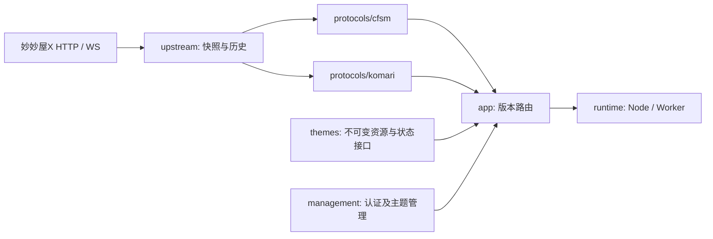

# 架构与目录约定

LeoBridge保持一个TypeScript项目、一个pnpm锁文件。推荐在VPS上部署单实例Node服务；Worker入口为实验性实现。按现有职责分层，不引入Monorepo框架、依赖注入容器或新数据库。

## 数据流与组合

这是数据/请求组合图，具体代码允许的导入方向以下表为准。共享模型和历史事实不含CFSM响应结构，两个协议各自转换；`app/protocols.ts`注入同一上游快照客户端，保持缓存与身份事实一致。默认single路由的根入口直接绑定当前活动主题，`/admin/`提供管理，切换活动主题关闭根入口旧实时连接。版本/预览主机仍绑定固定资源与协议；isolated路由保留根入口跳转。

## 目录和依赖边界

| 目录 | 职责 | 允许导入的项目层 |
| --- | --- | --- |
| `src/core` | 统一模型、身份、配置、错误、HTTP封装及Socket接口 | core |
| `src/upstream` | 妙妙屋HTTP读取、缓存/超时、中立历史序列 | core、upstream |
| `src/protocols/cfsm` | CFSM服务、序列化、Ping、历史和订阅 | core、upstream、cfsm本层 |
| `src/protocols/komari` | Komari RPC/REST、序列化及实时 | core、upstream、komari本层 |
| `src/themes` | 商店、静态包校验、安装确认及状态契约 | core、themes |
| `src/management` | 独立认证、管理API与源配置 | core、themes、management |
| `src/app` | 组合协议应用与站点路由 | 上述中立/功能层、app |
| `src/runtime` | Node/Worker入口、文件/R2/DO存储、代理 | 上述层、runtime |
| `web/admin` | 可信管理界面 | 仅管理HTTP API |
| `deploy` | 容器、反向代理及服务管理配置示例 | 不承载业务逻辑 |
| `scripts` / `tests` | 构建、初始化、架构检查和验证 | 可以组合被测模块，不被产品代码导入 |

不新增空层或无用途的`index.ts`。目前具体入口文件就是公开契约，例如`core/socket.ts`、`themes/store.ts`；新增可复用包后再考虑package exports。活动主题由持久化管理状态决定，不默认选择CFSM。产品构建只包含管理资源；历史主题来源档案不参与构建。

`pnpm check:architecture`用TypeScript AST读取import、export、import type和字面量动态import，拒绝跨层/跨生态依赖、缺失模块、依赖环和无法检查的动态模块加载。Node内置模块及Node专用传输依赖仅允许在runtime；Worker入口会递归检查可达依赖，避免误带Node能力。它是项目内约束检查，不代替类型、行为测试或供应链审查。

## VPS运行边界

反向代理由部署环境选择。应用约定HTTPS来源、Host及可信客户端IP的传递方式，不依赖nginx或Caddy的产品接口；仓库部署模板是该约定的一种配置示例。

Node默认single路由只开一个监听端口，local使用回环HTTP，direct用于显式配置的临时HTTP测试，proxy用于HTTPS反代。旧local+isolated配置保留多端口行为。只有允许的代理IP/CIDR可以提供单值`X-Forwarded-Proto=https`和`X-Real-IP`。Host必须匹配配置源或有效版本域；HTTP与WS使用同一验证函数。来自客户的Forwarded/X-Forwarded-Host/CF-Connecting-IP不能改变路由或绕过管理节流。

生产模式默认不读取`.dev.vars`。配置来自环境变量或显式`BRIDGE_ENV_FILE`；环境覆盖文件，日志不输出内容。文件存储在独立持久卷，按单站单副本运行。请求/WS有大小和数量界限，退出停止新请求、关闭上下游连接、终止出站连接池并限定排空时间。健康检查只检查进程，不访问真实源。

## 修改与验证

- 修改中立事实/单位时跑两个协议的转换和历史测试；身份约束不得因主题变化而降级。
- 修改主题源码时保留来源、许可证和PATCHES；最终兼容结论需要浏览器验收。目录搬迁必须检查构建输出和资源摘要。
- 修改Node入口时验证HTTP/WS反代、Origin/CSRF、客户端地址和持久化重启；反代模拟不等于真实nginx/TLS或VPS通过。
- 新上游适配实现中立模型；新主题生态实现独立协议。不得让协议之间通过互相调用响应转换来“兼容”。
- 运行`pnpm check`；Worker维护另运行`pnpm build:worker`。CI和本地实际结果分别记录。
